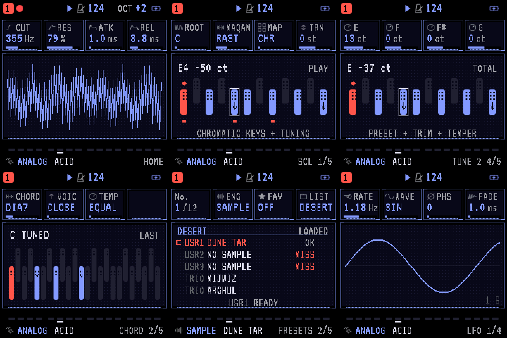

# SARDAB: AmbientZero colours and Bayer texture

Local build **sardab-2.3-bayer-ui-preview**, 18 October 2026.

## Appearance

SARDAB is the default on fresh settings. Its existing palette ID **11** now
uses AmbientZero-inspired black, deep blue, bright blue, pale text and red.
Existing saved SARDAB settings pick up the new colours. If another palette is
saved, choose **MENU → DISPLAY → COLOR → SARDAB**; saved alternatives remain.
The editor, emulator, installer and emulator manual share `web/sardab-theme.css`.
The editor's explicit light theme remains available.

| Role | Colour |
| --- | --- |
| Background | `#000000` |
| Surface | `#0A0A1E` |
| Text | `#DDDDEE` |
| Values and curves | `#8798FF` |
| Active controls and root | `#FF5648` |
| Web decorative blue | `#3333CC` |

The functional blue and red are brighter than AmbientZero's decorative colours
so small text remains legible. Device colours are quantized to RGB565.

One static **4 × 4 Bayer matrix** is shared by firmware drawing and web SVG
patterns. Device cells are one pixel; web cells are two CSS/SVG units. Backgrounds
use a faint 1/16 texture, keys use stronger densities, and dividers use 8/16.
Parameter cards remain solid. Text labels, root diamonds, tuning arrows and
selection outlines retain clear shapes. Pattern phase is stable across redraws.
No texture animation or audio processing was added.

Decorative torches are removed from **all firmware palettes**, including the
emulator. Graphs use their full existing panel width. The TORCH sound texture
is unrelated and remains available.

The emulator's narrow portrait layout now fits the viewport. Focus Screen also
uses the correct device container; click the display to enlarge it, click again
or press Escape to leave. Knob assignments and musical behavior are unchanged.
The [tuning and DESERT preset improvements](DESERT-UI.md) remain included.

## Verification

- Native UI suite, including the 150,000-frame redraw soak, passes.
- Focused DESERT UI suite passes: tuning readouts, live note lifecycle, sample
  validity/refresh, loaded status, full-width panels and stable partial Bayer redraws.
- **158 audio references unchanged**, zero health, routing or CPU-budget failures.
- Rebuilt WASM matches native audio for **88,200 stereo frames**, bit for bit.
- Web protocol tests pass against descriptors rebuilt from this source. Emulator
  DOM tests, package update/loader checks and target instruction budgets pass.
- UI audit: **238 scenes × 12 palettes**, styles, LARGE mode and 300,434 values.
  The existing **244 layout / 912 alignment findings** are unchanged. No invisible
  ink or nonneutral GREY/MONO pixels. Palette contrast checks pass.
- Isolated Chrome checks at **1100 px desktop / 390 px phone**: Switch on, actual
  audio output, a held key, Focus Screen/Escape, utility panel and editor mock
  connection/Samples tab. Editor light mode, manual and installer also inspected.
  Zero page exceptions, missing resources or document horizontal overflow.
  Visually checked text contrast, pattern density, button states, spacing, font
  loading and phone fit. Screenshots and logs: `build/assessment/bayer-ui/`.
- Application **575,616 / 581,564 bytes**, **5,948 free**; 392 bytes smaller than
  the previous DESERT UI build. Static RAM **59,172**, SDRAM pool **349,504**.
- Package **610,276 bytes**, `FM-1_900`, SHA-256
  `af0689c599957855934e8b986af3b35357437f6b07f2417c3d1cbe7715500b6a`.

## Use

Open the [local emulator](http://127.0.0.1:8792/webapp/emulator/) and refresh if it
was already open. The [local installer](http://127.0.0.1:8792/webapp/installer/)
contains this build. [Flashing instructions](FLASHING.md).
The portable bundle is `build/sardab-2.3-bayer-ui-preview.zip`.

Public distribution: [source on main](https://github.com/jrdntnnr/sardab/tree/main),
[emulator](https://jrdntnnr.github.io/sardab/webapp/emulator/) and
[installer](https://jrdntnnr.github.io/sardab/webapp/installer/).

This build has not been flashed onto a physical FM-1. Physical LCD contrast and sustained on-device performance remain to be checked. Desktop
Chrome checks use a mock connection for the editor, not a connected FM-1.
