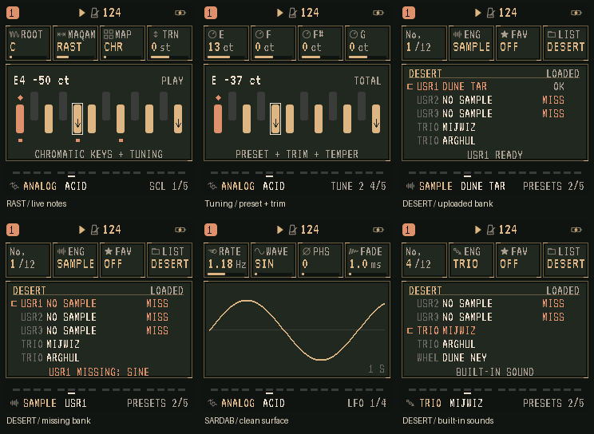

# SARDAB: tuning, DESERT presets and visual cleanup

Local build: **sardab-2.3-desert-ui-preview**, 18 October 2026.
The later [Bayer UI build](BAYER-UI.md) includes this work and replaces its colours
and torch treatment. Validation below records this earlier build.
This implements the three approved parts of the AmbientZero UI assessment.
Existing page navigation, knob assignments, audio, instruments and saved data
formats are unchanged.

## Tuning

On **SCL**, play a note to see its MIDI note name and effective tuning offset.
For Rast on C with equal temperament and zero trims, E4 reads **E4 −50 ct**.
This is the note's assigned tuning offset, not a frequency meter: pitch bend,
modulation, oscillator detune and global master tuning are not included.

- Diamond: tonic/root.
- Arrow inside a key: lowered or raised tuning.
- Outline: note whose offset is displayed.
- Small square below a key: a currently gated voice on the selected track.
  These follow mapped/chord notes, MIDI and the sequencer. Release tails are
  excluded; muting clears the playing indicators.

With multiple voices, the readout follows the newest gated voice. With none,
it returns to the root. Playing notes do not alter the keyboard mapping.

On **TUNE 1–3**, each knob now bears the actual note name relative to ROOT.
The knobs still edit the same **trim** values. The graph's **TOTAL** readout
follows the last-used knob on that page and includes:

**maqam preset + user trim + temperament**.

For example, Rast E at −50 ct with a +13 ct trim reads **E −37 ct**. Fractional
temperament offsets retain tenths of a cent. LARGE mode shows the total in its
lower strip; normal mode also shows the twelve-key graph.

## DESERT presets

Use the existing **PRESETS** page and set **knob 4 / LIST → DESERT**.
The list has a DESERT heading, five visible rows and a persistent status line.
Turning PRESETS still loads immediately. **LOADED** identifies the marked row's
sound; **NOT IN LIST** means the current sound is outside this filter.

**USR1–3** show the uploaded bank name where available:

- **OK / READY:** the slot passed the firmware's existing sample validation.
- **MISS / NO SAMPLE:** the bank is absent or invalid.
- **MISSING: SINE:** the loaded sample source is missing and uses the existing
  sine fallback. Flashing does not upload a Tar bank into a sample slot.

The view refreshes after a sample upload without requiring a page change.
READY verifies usable sample data, not whether the slot contains a particular
instrument. User-assigned bank names are displayed as supplied.

## SARDAB theme

Select **MENU → DISPLAY → COLOR → SARDAB** if another palette is saved.
SARDAB now uses solid surfaces behind text, thin geometric frames, bracket
cursors and no animated torches. Colours and existing fonts remain unchanged.
Legacy palettes retain their RPG decoration and saved palette IDs.

## Validation and limits

- Six focused native suites pass: DESERT UI, full UI (including the 150,000-frame
  redraw soak), tuning, chord tuning, DESERT integration and audio regression.
- Package update/loader checks pass. Target instruction budgets pass.
- **158 audio references unchanged**; native and rebuilt WASM audio match for
  **88,200 stereo frames**.
- **238 scenes × 12 palettes**, plus styles, LARGE mode and parameter sweeps:
  **244 pre-existing layout findings and 912 alignment findings**, unchanged
  from the before-build audit. No new findings on the six new scenes; no
  monochrome/greyscale or invisible-ink violations.
- App **576,008 / 581,564 bytes**: **5,556 free**, an increase of 1,872 bytes.
  Static RAM remains **59,172 bytes**, SDRAM pool **349,504 bytes**.
- Source renders, audit reports and logs: `build/assessment/desert-ui/`.

Physical FM-1 legibility and live-browser behavior still need testing. On the
device, check Rast E/B, transposed TUNE labels, a recorded chord, USR slot status
after an upload, and readability in your saved colour and LARGE settings.
The local installer is updated; this build has not been pushed publicly.
