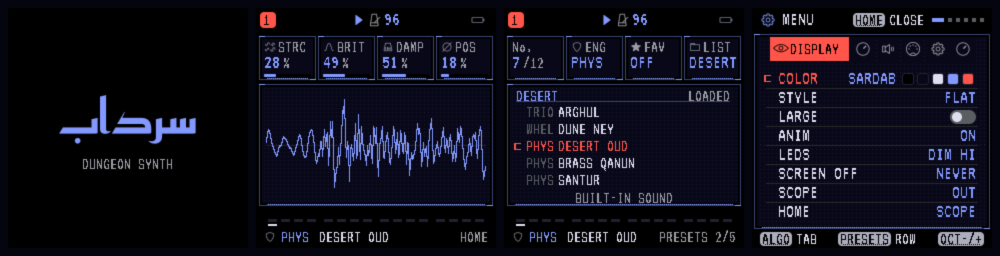

# Persian splash and current README screenshots

Build **sardab-2.3-persian-splash-preview**, 18 October 2026.

The splash now reads **سرداب**, shaped right-to-left with the bundled OFL
Reem Kufi font. Hardware, emulator and README captures use the same
`draw_splash()` function. The English DUNGEON SYNTH subtitle remains.

The 137 × 49 wordmark uses the existing Huffman font decoder: **584 bytes**
of compressed image/table data, with no additional runtime shaping library.
Colours follow the saved palette. The independent uncompressed reference is
compiled only into host rendering checks.

The README strip is regenerated from real 240 × 240 framebuffers at integer
2× scale, using the blue/red palette, torch-free HOME, DESERT preset collection
and current DISPLAY menu. Historical screenshots in earlier UI documents are
retained as historical evidence.

Validation: native splash pixels and labels pass in all 12 palettes; the
existing focused DESERT UI checks pass. Chrome's WASM boot framebuffer matches
the native splash exactly, inspected at 1100 px desktop and 390 px phone widths.
Checked shaping/joining, centering, contrast, clipping and subtitle spacing.
The emulator passes its boot, input, persistence and audio suite, matching the
previous native reference for **88,200 stereo frames**. Loader/update checks
and target instruction budgets pass. Full UI layout sweeps were not repeated
for this splash-only change; prior findings are documented in [Bayer UI](BAYER-UI.md).

Application: **576,240 / 581,564 bytes**, **5,324 free**. Static RAM and SDRAM
pool unchanged. Physical FM-1 validation remains pending.
Package SHA-256:
`ea418898dd0779b5debd348ce04b5f7e86d273ab9e6e79ef7a3b5252ac1ae16e`.

Source: [main](https://github.com/jrdntnnr/sardab/tree/main).
[Emulator](https://jrdntnnr.github.io/sardab/webapp/emulator/) ·
[Installer](https://jrdntnnr.github.io/sardab/webapp/installer/) ·
[Flashing instructions](FLASHING.md).

## Regenerate

Normal firmware builds use the checked-in `firmware/src/sardab_wordmark.h`.
Optional asset regeneration needs Pillow, fontTools with Brotli, and HarfBuzz
`hb-view`: `python3 tools/gen_sardab_wordmark.py`.
The generator checks the font coverage and lossless compression round trip.
See `tests/readme_shots.c` for its native compile/run commands; then use
`python3 tools/render_readme.py build/shots` to compose the screenshot strip.
